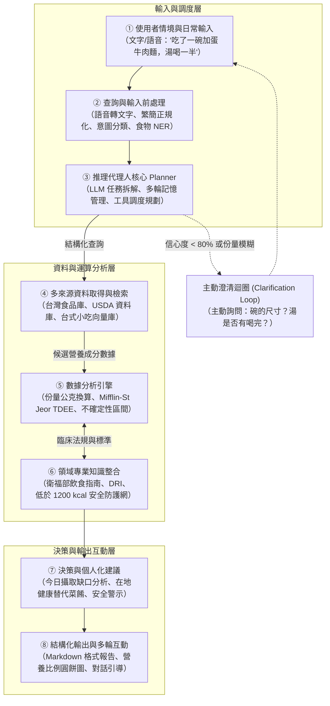

# DietSense：系統架構與工程設計文件 (DESIGN.md)

**專題名稱：** DietSense — 對話式日常熱量攝取分析領域智慧代理人 (Domain AI Agent)  
**專業領域：** 營養人工智慧 / 健康資訊學 (Nutrition AI / Health Informatics)  
**核心架構：** AI Agent + 領域專業知識 + 數據分析 + 真實世界應用  
**遵循規範：** DIC3 期末專題提案規範標準 ＆ OpenSpec 規格驅動開發工作流

---

## 一、問題定義與工程需求 (Problem & Requirements)

### 1.1 核心痛點與挑戰
- **資料庫搜尋負擔高：** 使用者必須在包含數十萬筆項目的資料庫中手動尋找完全吻合的食物名稱。
- **份量估算主觀模糊：** 自然語言描述（如「一碗」、「半份」）缺乏固定公克重量標準，自報誤差達 18%–54%。
- **複合料理拆解困難：** 面對外食與便當等複合菜餚，一般大眾難以自行拆解食材與烹調油脂比例。
- **在地飲食資料匱乏：** 歐美主流資料庫嚴重缺乏台灣夜市小吃、手搖飲與家常複合料理的營養數據。
- **純大型語言模型產生數值幻覺：** 通用 LLM 直接生成熱量時的平均絕對百分比誤差（MAPE）達 35.8%，缺乏可信度。

### 1.2 系統工程需求
- **需求 1 (自然語言解析)：** 能從中文飲食對話中抽取食物實體名稱、份量形容詞、餐別與時間情境。
- **需求 2 (多來源事實資料錨定)：** 平行查詢台灣衛福部食品成分資料庫、美國 USDA 資料庫與台式料理向量庫。
- **需求 3 (確定性計算引擎)：** 熱量與巨量營養素計算必須交由可驗證的確定性公式處理，嚴禁模型黑盒瞎猜。
- **需求 4 (不確定性區間量化)：** 依據比對相似度與模糊程度，輸出具信賴區間之熱量範圍 $[E_{\text{最低}}, E_{\text{最高}}]$。
- **需求 5 (主動澄清追問機制)：** 當信心度低於 80% 或關鍵份量模糊時，主動發起針對性追問。
- **需求 6 (臨床安全防護網)：** 強制攔截每日低於 1,200 大卡的危險過度節食目標，並對潛在飲食失調進行警示。

---

## 二、系統八大模組架構 (The 8-Module Framework)

DietSense 採用八大模組串接流程，將非結構化對話轉化為具科學依據的個人化營養回饋：



### 2.1 模組職責說明清單

| 模組編號 | 模組名稱 | 核心職責 | 輸入 / 輸出內容 |
|---|---|---|---|
| **①** | 使用者 / 應用情境 | 接收日常生活中的自然語言飲食對話（文字或語音）。 | 日常口語文字 → 原始輸入字串 |
| **②** | 查詢 / 輸入前處理 | 語音轉文字、語言偵測正規化、意圖分類與食物實體識別（NER）。 | 原始字串 → 正規化意圖標籤與食物實體清單 |
| **③** | 推理代理人核心 (Planner) | 拆解子任務、維護對話歷史記憶，並決定調用何種外部工具。 | 食物實體與上下文 → 工具調用執行計畫 |
| **④** | 資料取得 / 檢索 (RAG) | 平行檢索衛福部資料庫、USDA API 與向量資料庫，計算比對信心分數。 | 食物名稱 → 前 k 筆候選營養密度資料 |
| **⑤** | 數據分析引擎 | 執行確定性熱量換算、Mifflin-St Jeor BMR/TDEE 計算與不確定性信賴區間推導。 | 份量與營養密度 → $[E_{\text{最低}}, E_{\text{基準}}, E_{\text{最高}}]$ |
| **⑥** | 領域專業知識整合 | 比對衛福部每日飲食指南、巨量營養素比例範圍（AMDR）與臨床安全界限。 | 營養數值 → 臨床與衛教規則比對結果 |
| **⑦** | 決策 / 個人化建議 | 評估今日攝取與個人 TDEE 差距，產出在地菜餚替換建議與安全警戒。 | 每日總計 vs 目標 → 個人化具體調整建議 |
| **⑧** | 結構化輸出與多輪互動 | 生成排版優良之 Markdown 總結卡片、營養分佈圖表與後續對話引導。 | 綜合分析成果 → 視覺化圖表與對話回覆 |

---

## 三、系統運作流程圖與泳道決策邏輯 (Flowchart)

```mermaid
graph TD
    A["使用者輸入飲食描述"] --> B["文字前處理與意圖分類"]
    B --> C{"意圖分類結果？"}
    
    C -->|記錄飲食 (log_food)| D["命名實體識別 (NER)：抽取食物、份量、餐別"]
    C -->|查詢營養 (query_nutrition)| E["直接檢索食品營養成分資料庫"]
    C -->|攝取分析 (analyze)| F["彙整當日累積熱量與進度分析"]
    C -->|調整建議 (recommend)| G["依據能量赤字產生在地飲食調整建議"]
    
    D --> H["多來源平行檢索\n（衛福部食品庫 + USDA + 向量資料庫）"]
    H --> I["候選項目排序並計算比對信心分數"]
    
    I --> J{"信心度 >= 80% 且份量明確？"}
    J -->|否| K["觸發澄清追問\n（例如：請問是大碗還是小碗？湯有喝完嗎？）"]
    K --> L["等待使用者補充回答"] --> D
    
    J -->|是| M["確定性熱量計算：\n熱量 = 份量(g) × 每百克熱量 / 100"]
    M --> N["計算熱量信賴區間：\n[最低估算, 最高估算]"]
    N --> O["更新使用者當日飲食紀錄日誌"]
    
    O --> P["比對個人 Mifflin-St Jeor TDEE 目標"]
    P --> Q{"臨床安全檢查\n（當日總量 < 1200 kcal 或暴食-節食循環？）"}
    
    Q -->|偵測到危險| R["觸發安全警戒：拒絕過度限制並提醒諮詢專業營養師"]
    Q -->|數值正常| S["格式化輸出：巨量營養素圓餅圖、熱量區間與後續引導"]
    
    E --> S
    F --> S
    G --> S
    R --> T["呈現回覆給使用者"]
    S --> T
```

---

## 四、核心演算法與具行號虛擬碼 (Algorithm & Pseudocode)

```python
"""
演算法 1：DietSense 領域智慧代理人核心運作管線 (DietSense Domain AI Agent Pipeline)
輸入：使用者輸入查詢 Q、使用者生理個人檔案 P（年齡、性別、身高、體重、活動係數）、當日飲食日誌 D
輸出：格式化回覆 R、更新後之當日飲食日誌 D'
"""

01: def diet_agent(Q: str, P: UserProfile, D: DailyLog) -> tuple[Response, DailyLog]:
02:     # 步驟 1：輸入接收與文字繁簡正規化
03:     Q_norm = normalize_input(Q)  # 語言偵測、標點與字元統一
04:     
05:     # 步驟 2：使用者意圖分類
06:     intent = classify_intent(Q_norm)  # 包含：log_food, query_nutrition, analyze, recommend
07:     
08:     # 步驟 3：依據意圖進行任務分支處理
09:     if intent == "log_food":
10:         entities = extract_food_entities(Q_norm)  # NER：抽取食物名稱、份量形容詞、餐別
11:         
12:         for food in entities:
13:             # 步驟 4：多來源資料庫平行檢索
14:             candidates = []
15:             candidates += query_taiwan_food_db(food.name)  # 台灣衛福部食品成分資料庫
16:             candidates += query_usda_api(food.name)        # 美國農業部 USDA 資料庫
17:             candidates += query_vector_rag(food.name)      # 自建台式小吃向量檢索庫
18:             
19:             # 步驟 5：候選結果排序與信心分數評估
20:             best_match, confidence = rank_candidates(candidates, food.context)
21:             
22:             # 步驟 6：主動澄清追問機制 (Clarification Loop)
23:             if confidence < 0.80 or food.portion_ambiguous:
24:                 clarification_q = generate_clarification_question(food, candidates)
25:                 user_reply = await ask_user(clarification_q)
26:                 food = update_entity(food, user_reply)
27:                 best_match, confidence = rank_candidates(query_all(food.name), food.context)
28:             
29:             # 步驟 7：確定性熱量換算與不確定性信賴區間計算
30:             portion_grams = estimate_portion_grams(food.portion_desc, best_match)
31:             kcal_point = portion_grams * best_match.kcal_per_100g / 100.0
32:             kcal_low, kcal_high = compute_confidence_interval(kcal_point, confidence)
33:             
34:             # 步驟 8：寫入每日飲食日誌
35:             D.add_entry(
36:                 food=best_match,
37:                 portion_g=portion_grams,
38:                 kcal=(kcal_low, kcal_point, kcal_high),
39:                 meal=food.meal_type,
40:                 timestamp=food.time
41:             )
42:             
43:     elif intent == "analyze":
44:         # 步驟 9：當日攝取總量彙整與巨量營養素比例計算
45:         daily_total = sum(item.kcal_point for item in D.entries)
46:         macro_ratio = compute_macro_distribution(D)  # 計算碳水化合物、蛋白質、脂肪比例
47:         
48:         # 步驟 10：個人化基礎代謝與總消耗計算 (Mifflin-St Jeor 公式)
49:         bmr = calculate_bmr_mifflin(P.weight_kg, P.height_cm, P.age, P.gender)
50:         tdee = bmr * P.activity_factor
51:         energy_gap = daily_total - tdee  # 計算熱量赤字或盈餘
52:         
53:     elif intent == "recommend":
54:         recommendation = generate_meal_recommendations(D, P, tdee=tdee)
55:         
56:     # 步驟 11：臨床安全守門檢查 (Safety Guardrail)
57:     safety_status = evaluate_safety_guardrails(D, P)
58:     if safety_status == "DANGER_SEVERE_RESTRICTION":
59:         alert = generate_safety_alert("當日熱量低於 1,200 大卡安全下限，已暫停進一步限制建議。")
60:         return format_response(alert=alert), D
61:         
62:     # 步驟 12：格式化綜合結果輸出
63:     R = format_response(
64:         intent=intent,
65:         daily_log=D,
66:         analysis=(daily_total, tdee, energy_gap, macro_ratio) if intent == "analyze" else None,
67:         recommendation=recommendation if intent == "recommend" else None,
68:         sources=[item.source for item in D.entries]
69:     )
70:     return R, D
```

---

## 五、領域專業數學與計算公式

### 5.1 食物熱量標準換算公式
$$E = \text{份量重量 (g)} \times \frac{\text{每百公克熱量 (kcal)}}{100}$$

### 5.2 Mifflin-St Jeor 基礎代謝率與 TDEE 估算公式
$$\text{BMR}_{\text{男性}} = 10 \times \text{體重(kg)} + 6.25 \times \text{身高(cm)} - 5 \times \text{年齡(歲)} + 5$$
$$\text{BMR}_{\text{女性}} = 10 \times \text{體重(kg)} + 6.25 \times \text{身高(cm)} - 5 \times \text{年齡(歲)} - 161$$
$$\text{TDEE} = \text{BMR} \times \text{活動係數 (PAL)}$$

### 5.3 不確定性信賴區間量化公式
$$\text{邊界誤差 (Margin)} = E_{\text{基準點}} \times \left(0.10 + 0.50 \times (1 - \text{信心分數})\right)$$
$$E_{\text{最低}} = E_{\text{基準點}} - \text{邊界誤差}, \quad E_{\text{最高}} = E_{\text{基準點}} + \text{邊界誤差}$$

---

## 六、OpenSpec 規格驅動驗證與專案交接保證

本設計文件完全與專案的 OpenSpec 規格體系保持即時連動：
- 需求提案文件：`openspec/changes/dietsense-proposal-refactor/proposal.md`
- 核心功能規格：`openspec/changes/dietsense-proposal-refactor/specs/**/*.md`
- 工程任務追蹤：`openspec/changes/dietsense-proposal-refactor/tasks.md`

後續接手開發者只需在終端機輸入下列指令，即可在無歧義情況下進行規格驗證與功能擴充：
```powershell
openspec validate dietsense-proposal-refactor
```
