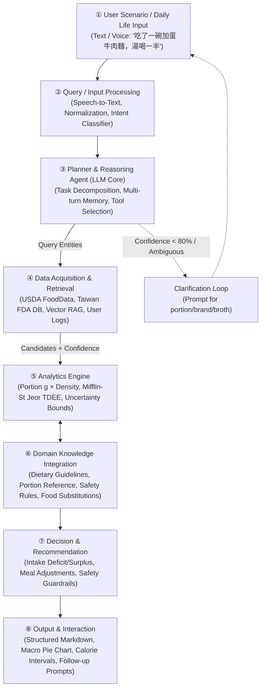

# Design: DietSense Conversational Domain AI Agent

## Context

DietSense transforms passive calorie tracking into an active, context-aware, and safety-oriented conversational workflow (see `proposal.md` for motivation and background). To prevent LLM hallucinations, the system decouples natural language understanding from numerical computation: the LLM acts as an orchestrator/planner using function calling, while all nutritional values and energy balance formulas are computed deterministically.

## Goals / Non-Goals

**Goals:**
- Implement an 8-module agentic pipeline executing natural language intake, retrieval, deterministic analysis, and proactive clarification.
- Ground nutritional calculation in USDA FoodData Central, Taiwan FDA Food Composition Database, and a local Taiwanese dish vector index.
- Communicate uncertainty via bounded caloric intervals based on retrieval confidence and portion descriptions.
- Enforce clinical safety guardrails (<1,200 kcal/day cutoff and eating disorder behavioral triggers).

**Non-Goals:**
- Medical diagnostic or prescription claims (DietSense provides supportive wellness tracking, not clinical medical treatment).
- Computer vision 3D volumetric food scanning in the initial MVP (photo inputs may be added as an optional multimodal extension, but conversational text is primary).
- Real-time continuous glucose monitor (CGM) sensor hardware pairing in Phase 1.

## Architecture: The 8-Module Framework



### Module Specifications

1. **① User / Application Scenario**:
   - Captures daily natural language descriptions via mobile/web chat. Example: "我剛剛吃了一碗加蛋的台式牛肉麵，湯喝了一半".
2. **② Query / Input Processing**:
   - Audio transcription (Whisper API), traditional/simplified normalization, language detection, and intent classification (`log_food`, `query_nutrition`, `get_analysis`, `get_recommendation`).
3. **③ Planner & Reasoning Agent**:
   - LLM Planner (e.g., GPT-4o / Gemini 1.5 Pro) decomposes input into subtasks, manages conversation state, selects tools, and initiates clarification loops.
4. **④ Data Acquisition / Retrieval**:
   - Parallel querying of USDA FoodData Central, Taiwan FDA Food Database (6,000+ items), local Taiwanese dish vector database (RAG), and user historical logs.
5. **⑤ Analytics Engine**:
   - Deterministic energy calculations: $E = \text{portion(g)} \times \text{kcal}_{100g} / 100$.
   - BMR calculation via Mifflin-St Jeor equation and TDEE calculation with physical activity coefficients.
   - Uncertainty quantification generating lower and upper confidence bounds.
6. **⑥ Domain Knowledge Integration**:
   - Taiwan Daily Dietary Guidelines, Dietary Reference Intakes (DRIs), standard container volumes (e.g., standard bowl = 300 ml), and safe lower limits (<1,200 kcal/day).
7. **⑦ Decision / Recommendation**:
   - Calorie deficit/surplus evaluation, personalized macro gap analysis, healthier Taiwanese food substitutions, and eating disorder risk alerts.
8. **⑧ Output & Interaction**:
   - Rich Markdown summaries, macronutrient distribution charts, calorie interval ranges, and conversational follow-up triggers.

---

## Decisions & Technical Rationales

### Decision 1: Orchestration Architecture — LLM Planner + Deterministic Tools
- **Choice**: LLM handles intent extraction and tool dispatching; deterministic math modules perform all calorie and macro calculations.
- **Alternatives Considered**: Direct end-to-end LLM generation ("Ask ChatGPT how many calories").
- **Rationale**: Direct LLM generation exhibits a 35.8% MAPE error and high hallucination rates. Tool-grounded execution ensures 100% mathematical auditability and reproducible calculations.

### Decision 2: Multi-Source Nutrition Grounding with Taiwanese Localization
- **Choice**: Tiered retrieval combining Taiwan FDA Food Database, USDA FoodData Central, and a customized ChromaDB vector store of Taiwanese night market and street foods.
- **Alternatives Considered**: Relying solely on USDA FoodData Central.
- **Rationale**: USDA data lacks coverage for Asian and Taiwanese culinary specialties (pearl milk tea, chicken cutlet, oyster omelet, beef noodle soup with broth variance).

### Decision 3: Uncertainty Quantification over Single Point Estimates
- **Choice**: Output calorie intervals $[E_{\text{low}}, E_{\text{high}}]$ parameterized by retrieval confidence and portion description ambiguity:
  $$\text{Margin} = E_{\text{point}} \times (0.10 + 0.50 \times (1 - \text{Confidence}))$$
- **Alternatives Considered**: Exact single-number outputs (e.g., "752 kcal").
- **Rationale**: Self-reported dietary errors range between 18% and 54%. Pretending to have single-calorie precision misleads users and undermines trust.

### Decision 4: Clarification Loop for Low Confidence (<80%)
- **Choice**: When food identification or portion size is ambiguous, the agent actively pauses and asks a targeted question (e.g., "Was it a small or large bowl? Did you drink the broth?").
- **Alternatives Considered**: Guessing default values silently.
- **Rationale**: Balances user burden with estimation accuracy. Targeted multi-turn clarification eliminates the largest source of error in dietary tracking.

### Decision 5: Clinical Safety Guardrails
- **Choice**: Hard-coded rule engine intercepts any advice or budget below 1,200 kcal/day or recurrent restriction patterns.
- **Alternatives Considered**: Allowing the user to freely set any deficit goal.
- **Rationale**: Prevents AI-assisted anorexia or malnutrition. Ethical AI agents must prioritize user health over blind goal compliance.

---

## Algorithms and Operational Pseudocode

```python
"""
Algorithm 1: DietSense Domain AI Agent Operational Pipeline
Input : User Query Q, User Profile P, Daily Intake Log D
Output: Formatted Response R, Updated Daily Intake Log D'
"""

01: def diet_agent(Q: str, P: UserProfile, D: DailyLog) -> tuple[Response, DailyLog]:
02:     # Step 1: Input Preprocessing & Normalization
03:     Q_norm = normalize_input(Q)  # Language detection, character normalization
04:     
05:     # Step 2: Intent Classification
06:     intent = classify_intent(Q_norm)  # log_food | query_nutrition | analyze | recommend
07:     
08:     # Step 3: Intent Branching
09:     if intent == "log_food":
10:         entities = extract_food_entities(Q_norm)  # NER: food names, portions, meals
11:         for food in entities:
12:             # Multi-source parallel retrieval
13:             candidates = []
14:             candidates += query_taiwan_food_db(food.name)
15:             candidates += query_usda_api(food.name)
16:             candidates += query_vector_rag(food.name)
17:             
18:             best_match, confidence = rank_candidates(candidates, food.context)
19:             
20:             # Clarification Loop
21:             if confidence < 0.80 or food.portion_ambiguous:
22:                 clarification_prompt = generate_clarification_question(food, candidates)
23:                 user_clarification = await ask_user(clarification_prompt)
24:                 food = update_entity_with_reply(food, user_clarification)
25:                 best_match, confidence = rank_candidates(query_all(food.name), food.context)
26:             
27:             # Deterministic Nutrition & Uncertainty Computation
28:             grams = estimate_portion_grams(food.portion_desc, best_match)
29:             kcal_point = grams * best_match.kcal_per_100g / 100.0
30:             kcal_low, kcal_high = compute_confidence_interval(kcal_point, confidence)
31:             
32:             D.add_entry(food=best_match, portion_g=grams,
33:                         kcal=(kcal_low, kcal_point, kcal_high), meal=food.meal_type)
34:                         
35:     elif intent == "analyze" or intent == "recommend":
36:         daily_total = sum(item.kcal_point for item in D.entries)
37:         macro_ratio = compute_macro_distribution(D)
38:         
39:         # Mifflin-St Jeor Energy Expenditure
40:         bmr = calculate_bmr_mifflin(P.weight_kg, P.height_cm, P.age, P.gender)
41:         tdee = bmr * P.activity_factor
42:         energy_gap = daily_total - tdee
43:         
44:         if intent == "recommend":
45:             recommendations = generate_meal_recommendations(D, energy_gap, macro_ratio, P)
46:             
47:     # Step 4: Clinical Safety Verification
48:     safety_status = evaluate_safety_guardrails(D, P)
49:     if safety_status == "DANGER_SEVERE_RESTRICTION":
50:         alert_msg = generate_safety_alert("Daily intake below 1,200 kcal threshold.")
51:         return format_response(alert=alert_msg), D
52:         
53:     # Step 5: Formatted Output Synthesis
54:     R = format_response(
55:         intent=intent,
56:         daily_log=D,
57:         analytics={"total": daily_total, "tdee": tdee, "gap": energy_gap, "macros": macro_ratio},
58:         sources=[item.source for item in D.entries]
59:     )
60:     return R, D
```

---

## Risks & Trade-offs

| Identified Risk | Impact | Architectural Mitigation |
|---|---|---|
| User fatigue from excessive clarification | Abandonment / friction | Limit clarification to max 1 question per item; default to standard medium portion when confidence is moderate (0.70–0.79). |
| Rare local dish not in any database | System failure or hallucination | Graceful degradation decomposing dish into macro proxies (carbohydrate base + protein + cooking oil) with widened uncertainty flags. |
| User misreporting portion size | Inaccurate energy balance | Provide visual hand-portion analogies (fist = 1 cup, palm = 3 oz meat, thumb = 1 tbsp) in clarification prompts. |
| Ingestion of conflicting nutritional metrics across DBs | Data discrepancy | Establish strict source precedence: Taiwan FDA for local specialties > USDA FoodData for whole foods > Vector RAG for complex composite dishes. |

